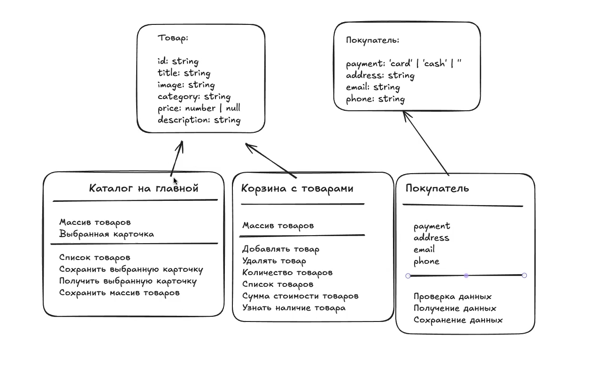

# Проектная работа "Веб-ларек"

Стек: HTML, SCSS, TS, Vite

Структура проекта:
- src/ - исходные файлы проекта
- src/components/ - папка с JS компонентами
- src/components/base/ - папка с базовым кодом

Важные файлы:
- index.html - HTML-файл главной страницы
- src/types/index.ts - файл с типами
- src/main.ts - точка входа приложения
- src/scss/styles.scss - корневой файл стилей
- src/utils/constants.ts - файл с константами
- src/utils/utils.ts - файл с утилитами

## Установка и запуск
Для установки и запуска проекта необходимо выполнить команды

```
npm install
npm run dev
```

или

```
yarn
yarn dev
```
## Сборка

```
npm run build
```

или

```
yarn build
```
# Интернет-магазин «Web-Larёk»
«Web-Larёk» - это интернет-магазин с товарами для веб-разработчиков, где пользователи могут просматривать товары, добавлять их в корзину и оформлять заказы. Сайт предоставляет удобный интерфейс с модальными окнами для просмотра деталей товаров, управления корзиной и выбора способа оплаты, обеспечивая полный цикл покупки с отправкой заказов на сервер.

## Архитектура приложения

Код приложения разделен на слои согласно парадигме MVP (Model-View-Presenter), которая обеспечивает четкое разделение ответственности между классами слоев Model и View. Каждый слой несет свой смысл и ответственность:

Model - слой данных, отвечает за хранение и изменение данных.  
View - слой представления, отвечает за отображение данных на странице.  
*Presenter* - презентер содержит основную логику приложения и  отвечает за связь представления и данных. Выполнен в главном файле main.ts, так как сайт одностраничный.

Взаимодействие между классами обеспечивается использованием событийно-ориентированного подхода. Модели и Представления генерируют события при изменении данных или взаимодействии пользователя с приложением, а Презентер обрабатывает эти события используя методы как Моделей, так и Представлений.

### Базовый код

#### Класс Component
Является базовым классом для всех компонентов интерфейса.
Класс является дженериком и принимает в переменной `T` тип данных, которые могут быть переданы в метод `render` для отображения.

**Конструктор:**  
`constructor(container: HTMLElement)` - принимает ссылку на DOM элемент за отображение, которого он отвечает.

**Поля:**  
`container: HTMLElement` - поле для хранения корневого DOM элемента компонента.

Методы класса:  
`render(data?: Partial<T>): HTMLElement` - Главный метод класса. Он принимает данные, которые необходимо отобразить в интерфейсе, записывает эти данные в поля класса и возвращает ссылку на DOM-элемент. Предполагается, что в классах, которые будут наследоваться от `Component` будут реализованы сеттеры для полей с данными, которые будут вызываться в момент вызова `render` и записывать данные в необходимые DOM элементы.  
`setImage(element: HTMLImageElement, src: string, alt?: string): void` - утилитарный метод для модификации DOM-элементов ``


#### Класс Api
Содержит в себе базовую логику отправки запросов.

Конструктор:  
`constructor(baseUrl: string, options: RequestInit = {})` - В конструктор передается базовый адрес сервера и опциональный объект с заголовками запросов.

**Поля:**  
`baseUrl: string` - базовый адрес сервера  
`options: RequestInit` - объект с заголовками, которые будут использованы для запросов.

Методы:  
`get(uri: string): Promise<object>` - выполняет GET запрос на переданный в параметрах ендпоинт и возвращает промис с объектом, которым ответил сервер  
`post(uri: string, data: object, method: ApiPostMethods = 'POST'): Promise<object>` - принимает объект с данными, которые будут переданы в JSON в теле запроса, и отправляет эти данные на ендпоинт переданный как параметр при вызове метода. По умолчанию выполняется `POST` запрос, но метод запроса может быть переопределен заданием третьего параметра при вызове.  
`handleResponse(response: Response): Promise<object>` - защищенный метод проверяющий ответ сервера на корректность и возвращающий объект с данными полученный от сервера или отклоненный промис, в случае некорректных данных.

#### Класс EventEmitter
Брокер событий реализует паттерн "Наблюдатель", позволяющий отправлять события и подписываться на события, происходящие в системе. Класс используется для связи слоя данных и представления.

Конструктор класса не принимает параметров.

**Поля:**  
`_events: Map<string | RegExp, Set<Function>>` -  хранит коллекцию подписок на события. Ключи коллекции - названия событий или регулярное выражение, значения - коллекция функций обработчиков, которые будут вызваны при срабатывании события.

Методы класса:  
`on<T extends object>(event: EventName, callback: (data: T) => void): void` - подписка на событие, принимает название события и функцию обработчик.  
`emit<T extends object>(event: string, data?: T): void` - инициализация события. При вызове события в метод передается название события и объект с данными, который будет использован как аргумент для вызова обработчика.  
`trigger<T extends object>(event: string, context?: Partial<T>): (data: T) => void` - возвращает функцию, при вызове которой инициализируется требуемое в параметрах событие с передачей в него данных из второго параметра.

## Слой данных

В проектной работе будут использоваться интерфейсы для сущностей товара и покупателя.
В качестве моделей данных будут использоваться модели данных(классы) для каталога товаров на главной странице, корзины с товарами и покупателя.



### Интерфейсы

#### Интерфейс товара
```ts 
interface IProduct {
  id: string;
  description: string;
  image: string;
  title: string;
  category: string;
  price: number | null;
}
```

#### Интерфейс покупателя
```ts 
interface IBuyer {
  payment: TPayment;
  email: string;
  phone: string;
  address: string;
} 

type TPayment = 'card' | 'cash' | ''; // тип для способа оплаты

```

### Модели данных

Для учёта данных в проекте используется три класса, которые будут разделены между собой по смыслу и зонам ответственности:
  - хранение товаров, которые можно купить в приложении;
  - хранение товаров, которые пользователь выбрал для покупки;
  - данные покупателя, которые тот должен указать при оформлении заказа.

#### Класс для каталога товаров

Модель каталога товаров на главной странице. Хранит все товары, полученные от API для отображения на странице и товар, который выбрали

**Поля:**
- `items: IProduct[]` массив всех товаров.
- `selectedItem: IProduct | null` товар, выбранный для подробного отображения.

**Методы:**
- `setItems(items: IProduct[]): void` сохранить массив товаров, полученный в параметре.
- `getItems(): IProduct[]` получить массив товаров из модели.
- `getProductById(id: string): IProduct | undefined` получить один товар по его `id`.
- `saveSelectedItem(item: IProduct): void` сохранить товар для отображения.
- `getSelectedItem(): IProduct | null` получить товар для отображения.

#### Класс корзины

Модель корзины. Хранит массив товаров, выбранных покупателем для покупки.

**Поля:**
- `items: IProduct[]` массив товаров в корзине.

**Методы:**
- `getItems(): IProduct[]` получить массив товаров, находящихся в корзине.
- `addProduct(product: IProduct): void` добавить товар в массив корзины.
- `removeProduct(product: IProduct): void` удалить товар из массива корзины.
- `clear(): void` очистить корзину.
- `getTotal(): number` получить стоимость всех товаров в корзине.
- `getCount(): number` получить количество товаров в корзине.
- `contains(id: string): boolean` проверить наличие товара в корзине по его id.

#### Класс для покупателя

Хранит контактные данные и способ оплаты, которые ввел покупатель при оформлении заказа.

**Поля:**
- `payment: TPayment;` хранить вид оплаты, который выбрал покупатель, по карте или наличкой
- `address: string;` физический адрес покупателя
- `phone: string;` телефон покупателя
- `email: string;` email покупателя

**Методы:**
- `setData(data: Partial<IBuyer>): void` сохранить данные. Принимает любой объект с одним заполненным значением или всеми, не затирая остальные, уже заполненные.
- `getData(): IBuyer` получить все данные покупателя.
- `clear(): void` очистить данные покупателя.
- `validate(): ValidationErrors` провалидировать данные. Возвращает объект, где ключ - имя поля, значение(`ValidationErrors`) - текст ошибки. Если поле валидно, оно в объекте отсутствует.

**Валидация.** Поле считается валидным, если оно не пустое. Пример результата `validate()`:

```ts
{
  payment: 'Не выбран вид оплаты',
  email: 'Укажите email',
}
```

## Слой коммуникации

### Класс WebLarekApi

**Поля:**
- `api: IApi` - объект, реализующий интерфейс `IApi`.

**Конструктор:**
- `constructor(api: IApi)` - принимает объект с методами `get` и `post` (композиция).

**Методы:**
- `getProducts(): Promise<IServerResponse>` - делает GET-запрос на эндпоинт `/product/` и возвращает объект с массивом товаров.

- `postOrder(order: IOrderRequest): Promise<IOrderResponse>` - делает POST-запрос на эндпоинт `/order/` с данными о покупателе и выбранных им товарах, также возвращает ответ с объектом подтверждения покупки.

**Связанные типы:**
- `IServerResponse` - тип для ответа от эндпоинта `/product/` в виде `{ total: number; items: IProduct[] }`.

- `IOrderRequest extends IBuyer` - тип для запроса в виде `{ total: number; items: string[] }` который наследует тип покупателя эндпоинта `/order/`.

- `IOrderResponse` - `{ id: string; total: number }` - ответ от эндпоинта `/order/`.

## Слой представления (View)

Слой представления отвечает за отображение данных на странице и взаимодействие с пользователем. Все классы представления наследуются от базового компонента Component, который отвечает за рендеринг.

Классы view не хранят данные. Они получают их через сеттеры при вызове метода render() из `Component.ts`. Все действия пользователя классы представления транслируют через брокер событий (IEvents).


### Базовые классы

#### Абстрактный Класс Card

Базовый класс для всех карточек товара. Содержит общий функционал для отображения заголовка и цены, остальные элементы добавляются дочерними классами.

**Интерфейс ICard**

`title: string;` - название товара.
`price: number` - цена товара в синапсах.
`_title: string` - приватно хранит заголовок в поле

**Конструктор:**
`constructor(container: HTMLElement)` - принимает DOM-элемент карточки. Автоматически находит и сохраняет ссылки на общие элементы: .card__title и .card__price.

**Поля:**
`titleElement: HTMLElement` - заголовок товара.

`priceElement: HTMLElement` - цена товара.

**Методы:**
`set title(value: string)` - устанавливает заголовок.

`set price(value: number | null)` - устанавливает цену (если null, выводится «Бесценно», иначе добавляет `${value} синапсов`).

#### Абстрактный класс CardWithImage

Промежуточный класс для карточек с картинками и категориями. В корзине не будет категорий и картинок у товаров.

**Конструктор:**
`constructor(container: HTMLElement)` - ищем элементы картинки по '.card__image' и категории по '.card__category'

**Поля:**
`protected imageElement: HTMLImageElement;` - поле для картинки.
`protected categoryElement: HTMLElement;` - поле для категории.

**Методы:**
`protected set category(value: string)` - устанавливает категорию для товара, перебирая константу `categoryMap`.

`protected set image(value: string)` - устанавливает картинку товару в каталоге или превью.

#### Класс Form

Базовый класс для всех форм. Обрабатывает общую логику отправки формы и вывода ошибок.

**Интерфейс действий IFormState:**
`valid: boolean;` // Валидна ли форма (блокирует/разблокирует кнопку)
`errors: string;` // Текст ошибок для отображения пользователю

**Интерфейс действий IFormActions:**
`onSubmit: () => void;` - Вызывается при отправке формы
`onInput?: (fieldName: string, value: string) => void;` - Вызывается при вводе в любое поле

**Конструктор:**
`constructor(container: HTMLFormElement, actions: IFormActions)` - принимает форму и объект с колбэками.

Находит кнопку отправки (`button[type="submit"]`) и блок для вывода ошибок (`.form__errors`).

Вешает слушатель на событие submit всей формы. При отправке (клик по кнопке или нажатие Enter в поле) вызывается event.preventDefault() (защита от перезагрузки страницы) и колбэк actions.onSubmit().

Если передан actions.onInput, вешает слушатель на событие input всей формы. При вводе в любое поле ввода вызывается колбэк `actions.onInput()`, который передает имя поля и его текущее значение (value) в презентер.

**Поля:**
`submitButton: HTMLButtonElement` - кнопка отправки формы.

`errorsElement: HTMLElement` - контейнер для вывода текста ошибок.

**Методы:**
`protected set valid(value: boolean)` - включает/выключает кнопку отправки (через атрибут disabled).

`protected set errors(value: string)` - выводит текст ошибки.


### Компоненты карточек

**Интерфейс ICardActions:**
Нужен для классов карточек, описывающий передаваемые колбэки onClick

`onClick?: (event: MouseEvent) => void;` - клик по карточке или кнопке.

#### Класс CardCatalog

Наследуется от CardWithImage. Карточка товара в каталоге на главной странице (Gallery). Расширяет базовый класс, добавляя логику отображения категории и изображения товара. Принимает интерфейс `ICardActions`.

**Конструктор:**
`constructor(container: HTMLElement, actions?: ICardActions)`:
container - корневой DOM-элемент карточки;

actions - необязательный объект с действиями. Содержит метод onClick, который вызывается при клике на карточку.

При создании экземпляра вызывает конструктор родительского класса. Если в actions передан колбэк onClick, на весь контейнер карточки вешается слушатель события click. При клике вызывается переданная функция, в которую передается объект события.

#### Класс CardPreview

Наследуется от CardWithImage. Подробная карточка товара, отображаемая в модальном окне. Расширяет базовый класс, добавляя логику отображения описания, кнопки действия и управления её состоянием. Принимает интерфейс ICardActions и использует интерфейс ICardPreview для типизации данных.

**Интерфейс ICardPreview:**
`text: string;` - текстовое описание товара.
`buttonText: string;` - текст на кнопке действия (например, «Купить»).
`buttonDisabled: boolean;` - состояние кнопки (заблокирована или нет).

**Конструктор:**
`constructor(container: HTMLElement, actions?: ICardActions)`:
container - корневой DOM-элемент карточки товара.

actions - объект с колбэками для обработки действий пользователя. Содержит необязательный метод onClick.

При создании экземпляра вызывает конструктор родительского класса. Находит специфичные для превью элементы: блок с описанием (.card__text) и кнопку действия (.card__button). Если в actions передан колбэк onClick, вешает слушатель события click именно на кнопку (в отличие от карточки каталога, где слушается весь контейнер). При клике вызывается переданная функция, в которую передается объект события.

**Поля:**
`textElement: HTMLElement` - DOM-элемент с описанием товара.

`buttonElement: HTMLButtonElement` - элемент кнопки действия.

**Методы:**
`set text(value: string)` - устанавливает текст описания товара.

`set buttonText(value: string)` - изменяет текст на кнопке (например, «Купить», «Удалить из корзины»).

`set buttonDisabled(value: boolean)` - блокирует или разблокирует кнопку (например, для товаров с ценой null, которые нельзя купить).


#### Класс CardBasket

Наследуется от Card. Представляет собой компактную карточку товара, которая отображается в виде списка внутри модального окна корзины. Содержит порядковый номер товара и кнопку удаления.

**Интерфейс ICardBasket:**
`index: number;` - порядковый номер товара в корзине

**Конструктор:**
`constructor(container: HTMLElement, actions?: ICardActions)`:
container - корневой DOM-элемент карточки.

actions - объект с колбэками для обработки действий пользователя. Содержит необязательный метод `onClick`.

Находит специфичные для корзины элементы (`.basket__item-index и .basket__item-delete`). Если передан `actions.onClick`, вешает слушатель на клик именно по кнопке удаления (`deleteButton`).

**Поля:**
`indexElement: HTMLElement` - элемент, отображающий порядковый номер товара.

`deleteButton: HTMLButtonElement` - элемент кнопки удаления товара (иконка корзины у товара).

**Методы:**
`protected set index(value: number)` - устанавливает порядковый номер.


### Компоненты форм

#### Класс FormOrder

Наследуется от Form. Первый шаг оформления заказа.

**Конструктор:**
`constructor(container: HTMLFormElement, actions: IFormActions)`

**Поля:**
`cardButton: HTMLButtonElement` - кнопка для выбора оплаты картой.

`cashButton: HTMLButtonElement` - кнопка для выбора оплаты наличными.

`addressInput: HTMLInputElement` - поле ввода адреса.

**Методы:**
`set payment(value: TPayment)` - выделяет выбранную кнопку оплаты с помощью модификатора `button_alt-active`.

`set address(value: string)` - обновляет значение инпута.


#### Класс FormContacts

Наследуется от Form. Второй шаг оформления заказа (ввод email и телефона).

**Конструктор:**
`constructor(container: HTMLFormElement, actions: IFormActions)`

**Поля:**
  `emailInput: HTMLInputElement` - поле ввода email.

  `phoneInput: HTMLInputElement` - поле ввода телефона.

**Методы:**
Обновляют значения соответствующих инпутов.
`protected set email(value: string)`

`protected set phone(value: string)`

### Самостоятельные компоненты

#### Класс Modal
Модальное окно. Отвечает только за отображение и скрытие контейнера. Закрытие кликом по кнопке и за пределами модального окна.

**Интерфейс IModal:**
`content: HTMLElement` - элемент модального окна

**Конструктор:**
`constructor(container: HTMLElement)`:
Находит крестик закрытия (.modal__close) и контейнер контента (.modal__content). В конструкторе устанавливаются слушатели событий click на кнопку и на корневой контейнер.

**Поля:**
`closeButton: HTMLButtonElement` - кнопка закрытия (крестик).

`contentContainer: HTMLElement` - внутренний контейнер для динамического контента.

**Методы:**
`set content(value: HTMLElement)` - заменяет текущее содержимое модального окна на новый DOM-элемент с помощью метода replaceChildren.

`open(): void` - добавляет класс modal_active корневому контейнеру, что делает окно видимым (обычно через CSS-анимацию).

`close(): void` - удаляет класс modal_active, скрывая окно.


#### Класс Basket

Представляет собой корзину товаров, которая отображается в модальном окне. Содержит список карточек товаров, общую стоимость и кнопку оформления заказа.

**Интерфейс IBasketView:**
`items: HTMLElement[];` - Массив DOM-элементов карточек (CardBasket).
`total: number;` - Общая стоимость товаров в корзине.
`disabled: boolean;` - Состояние кнопки, когда товаров нет в корзине

**Интерфейс IBasketActions:**
`onSubmit: () => void;` // Колбэк, вызываемый при клике на кнопку "Оформить"

**Конструктор:**
`constructor(container: HTMLElement, actions?: IBasketActions)`:
Находит список (`.basket__list`), итоговую цену (`.basket__price`) и кнопку оформления (`.basket__button`). Если передан actions.onSubmit, вешает на кнопку слушатель клика, вызывающий колбэк.

**Поля:**
`listElement: HTMLElement` - контейнер для списка карточек.

`totalElement: HTMLElement` - элемент для отображения итоговой суммы.

`submitButton: HTMLButtonElement` - кнопка оформления заказа.

**Методы:**
`set items(items: HTMLElement[])` - обновляет список карточек (`replaceChildren`). 

`protected set total(value: number)` - обновляет текст итоговой суммы (добавляет суффикс "синапсов").

`set disabled(value: boolean)` - Деактивирует кнопку для перехода в форму.


#### Класс Success
Элемент успешного оформления заказа.

**Интерфейс ISuccess:**
`totalAmount: number;` - Итоговая сумма заказа

**Интерфейс действий ISuccessActions:**
`onClose: () => void;` - Колбэк, вызываемый при клике на кнопку "За новыми покупками!"

**Конструктор:**
`constructor(container: HTMLElement, actions: ISuccessActions)`:
Находит элемент с описанием (`.order-success__description`) и кнопку закрытия (`.order-success__close`). Если передан `actions.onClose`, вешает на кнопку слушатель клика, который вызывает этот колбэк.

**Поля:**
`totalDescriptionElement: HTMLElement` - текст с конечной суммой покупки.

`closeButton: HTMLButtonElement` - кнопка "За новыми покупками!" для закрытия окна.

**Методы:**
`set totalAmount(value: number)` - устанавливает списанную сумму.


#### Класс Gallery
Отвечает за отображение списка карточек товаров на главной странице.

**Интерфейс IGallery**
`items: HTMLElement[]` - элемент каталога

**Конструктор:**
`constructor(container: HTMLElement)` - принимаем элемент с классом `gallery`.

**Методы:**
`set items(items: HTMLElement[])` - принимает массив элементов карточек и отрисовывает их на странице с помощью `this.container.replaceChildren(...items)`


#### Класс Header
Отвечает за отображение шапки сайта, иконки корзины и счетчика товаров в ней.

**Интерфейс**
`counter: number` - количество товаров в корзине

**Конструктор:**
`constructor(container: HTMLElement, actions?: ICardActions)` принимает контейнер с классом `header` и события для кнопки корзины.

Находит кнопку корзины (`.header__basket`) и элемент счетчика (`.header__basket-counter`). Если передан `actions.onClick`, вешает на кнопку слушатель клика, который вызывает этот колбэк, передавая ему объект события (MouseEvent).

**Поля:**
`basketButton: HTMLButtonElement` - кнопка открытия модального окна корзины.

`counterElement: HTMLElement` - счетчик товаров в корзине.

**Методы:**
`set counter(value: number)` - устанавливает количество товаров в корзине.


## Презентер

Презентер реализован в файле main.ts в виде набора обработчиков событий, так как проект представляет собой одностраничное приложение. Содержит основную бизнес-логику приложения.

**Основные задачи Презентера:**

Связывать слой данных (Models) и слой отображения (Views).

Слушать события, поступающие от пользователя (клики, ввод текста) в слое Views и вызывать соответствующие методы моделей.

Слушать события изменения данных от моделей и обновлять интерфейс (вызывать метод render() у слоя Views).

**Принципы реализации:**

Обработчики (колбэки), которые передаются в компоненты Представления (например, onClick или onInput), не содержат логики и не обращаются к моделям напрямую. Их единственная задача - сгенерировать событие с помощью брокера событий (events.emit). Вся обработка этого события происходит внутри соответствующего метода events.on(...).

### События слоя данных (Model)

`catalog:changed` - "Изменение массива товаров в каталоге (загрузка или обновление)."

`item:selected` - "Изменение выбранного для подробного просмотра товара."

`basket:changed` - "Изменение содержимого корзины (добавление, удаление или очистка)."

`buyer:changed` - "Изменение данных покупателя (ввод в формы или очистка)."

### События слоя представления (View)

`item:select` - "Клик по карточке товара в каталоге (передает объект выбранного товара)."

`product:toggle` - "Клик по кнопке «Купить» или «Удалить из корзины» в превью товара."

`basket:open` - "Клик по иконке корзины в хедере."

`basket:remove` - "Клик по кнопке удаления товара в карточке корзины (передает удаляемый товар)."

`order:open` - "Клик по кнопке «Оформить» в корзине."

`order:next` - "Отправка первой формы заказа (переход ко второй форме с контактами)."

`order:submit` - "Отправка второй формы заказа (выполнение оплаты)."

`form:changed` - "Ввод данных в поля форм (передает имя поля и его текущее значение)."

`modal:close` - "Клик по кнопке «За новыми покупками!» на экране успешного оформления заказа."